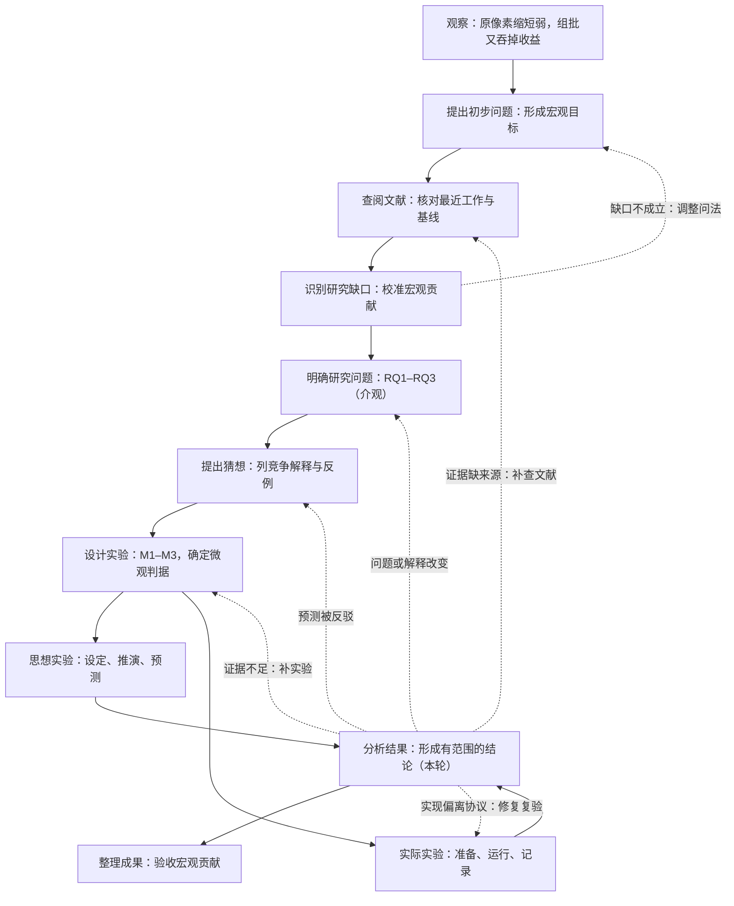

# 研究计划 Research Plan MBPE

## 当前进度与总流程

用户最新要求以“一个内容token占一个同宽embedding位置”的sequence长度为主，文本按字符、图像按通道像素值作各自原始位置；最新[长度结论](<../研究记录 Research Record/2026-11-15 文本与图像的序列长度对照.md>)已纳入MNIST一维补测。以下E1/E2/E4的等容量打包合同保留历史原义，不能把其额外位置收益当成这个主口径的降幅。

2026-11-15 按研究流程重排。**本轮已完成“补查文献 → 校准候选缺口 → 实施 E4 → 分析 RQ1”，E2 也已完成；分析结果回到宏观贡献与候选缺口判断。** E4 支持 W128 累计输入节省 6.80%/22.59%却未降低最大单批；E2 中差分二维比强一维多 0.46%/0.78%位置，不支持本场景的几何优势。完整依据见[本轮结论](<../研究记录 Research Record/2026-11-15 有限窗口收益与二维独立作用.md>)。已有 CPU 实验能支持局部事实，但尚未确认新的多维 BPE 方法贡献；不能把当前位置写成“论文路线已经确定，只需继续跑实验”。

宏观目标在提出初步问题时形成，在识别研究缺口时校准，在整理成果时验收；介观问题承接校准后的贡献目标，微观设计负责取得能回答问题的证据。三层目标贯穿同一流程，不是三个互不相干的目录。

| 流程环节 | 本项目已有什么、当前还缺什么 | 向下一步交什么 |
| --- | --- | --- |
| 提出初步问题 | 用户希望发展通用多维无损 BPE；真实像素结果触发输入收益疑问 | 初步问题与预期受益者，不能预先认定二维必胜 |
| 查阅文献 | Elsner 等已有定向阅读；本轮补读 MEGABYTE、BLT 和序列打包方法，任务效果比较仍不足 | 最近工作在相同对象、输入合同和指标下的证据表 |
| 识别研究缺口 | 已知若干本地未知项，但尚不能说领域无人回答 | 可定位的候选缺口、其价值及校准后的贡献目标 |
| 明确问题、提出猜想 | RQ1–RQ3 和竞争解释已有候选版本 | 经缺口核对后保留、收窄或替换的问题 |
| 设计与实施 | E1/E4/E2 已执行并独立还原，E3 未执行，思想场景不算实测 | 微观证据、原始回执及协议偏离记录 |
| 分析结果 | E4 支持 W128 累计输入收益，但最大单批更大，尚不能声称峰值节省；E2 当前二维略差于强一维，不支持几何优势 | 对介观问题的条件性结论，以及回到哪一步的决定 |
| 整理成果 | 有阶段报告和代码，尚无已确认创新的论文方法 | 证据支持的贡献、未覆盖范围和可复查资产 |

下面按这条流程展开。当前只做 CPU 整数编码、还原及输入张量核算，神经网络任务效果不在本阶段范围内。 [项目约定](../../REPO.md) · [统合报告](<../研究报告 Research Report/2026-11-14 MBPE 研究统合报告.md>)

## 提出初步问题：形成宏观目标

**最初的问题。** 能否在 Elsner 多维 BPE 基础上，发展适用于不同形状整数格点的无损切词，并比简单表示少占模型输入？“任意形状”是想覆盖的输入范围，“降低输入开销”是预期用途，二者都还需要与已有研究核对。

**希望改变什么。** 为需要保留全部原始信息的视觉与格点序列研究，探索更省输入开销的表示方法。直接使用者是研究这类数据的建模与算法人员；若后续模型有效性也成立，才有望降低其处理长序列的资源门槛。当前 CPU 证据只涉及输入表示，尚不能声称实际模型更省显存、训练更快或使用成本已下降。

**本课题要贡献什么知识或方法。** 在 Elsner 基础上研究通用多维可逆切词，目标是形成一套输入域、逆映射和额外信息均明确的表示，以及相对强一维和固定分组的适用边界。当前尚未选定一个已证明新颖的改进算法；若后续发现可复核的几何收益，再据其机制设计改进。发论文是传播贡献的载体，不以跑完批次代替贡献，也不把已有差分、Re-Pair 或组批做法重新命名为创新。

**怎样验收宏观贡献。** 正确性由逆映射证明及独立实现检查支撑；多维方法的价值由相对强一维的受控比较支撑；输入节省由完整输入计费及组批证据支撑。三者共同限制最终能说什么，任一项通过都不能代替另两项。即使全部通过，也只得到编码和输入层证据，仍需最近工作比较判断是否有论文贡献；本阶段不验收神经网络任务可用性。若二维没有独立优势，或额外输入开销抵消收益，就收窄为适用边界与比较结论，重新判断是否足以立题。

这些是立题时的目标与验收方向，尚不是已确认的研究缺口。已有观察如下，用来引导检索和校准目标：

| 已有结论与直接依据 | 本地证据尚未覆盖 | 会改变什么决定 |
| --- | --- | --- |
| RGB E1：差分二维 BPE 比固定分组平均再省 CIFAR 10.31%、SVHN 25.84% 输入位置，全部独立还原 | 固定词表、32×32 RGB、单次学习切分；不是所有图片都缩短 | 保留可逆残差路线，不再把“原像素 BPE token 少了”当作净收益 |
| 同一 E1，batch=16 固定顺序补齐后 CIFAR 反增 2.45%，SVHN 只省 5.15% | 长度分布与组批规则影响收益；窗口排序只有事后核算 | 下一步先检验有限缓存组批，而不是继续追单图均值 |
| 第 35–40 批中，方向和强一维解释了部分二维/Hilbert 差距 | 本轮 E2 同预算差分二维略差于按列一维 | 已补强一维，不再以本场景二维优胜立题 |
| 既有候选覆盖带孔、多维和未知整数的部分往返；固定 RGB 残差输入另有合同 | 可逆预测还未扩展到这些域，完整边信息可能抵消收益 | 将“任意形状能还原”和“任意形状都更短”分开检验 |

E1 数字见[RGB 结论](<../研究记录 Research Record/2026-11-14 RGB独立样本与批次补齐结论.md>)与[运行证据](<../运行记录 Run Record/2026-11-14 RGB独立样本等容量输入对照.md>)，历史空间对照见[阶段结论](<../研究记录 Research Record/2026-11-14 CPU BPE 阶段结论.md>)。**E1 和第 32–40 批不重跑**；原协议和计划演变归[计划存档](<计划存档 Plan Archive/README.md>)。

## 查阅文献：检验初步设想

线索来自两个反常观察：原像素 BPE 少留 token，却因 9 位编号及补齐而占更多输入；差分 BPE 的单图平均改善，又被批次最长样本部分抵消。需要解释的是收益产生与消失的条件，而不是先假定二维一定获胜。

最近证据沿用[文献调研](<../调研 Search/文献调研 Literature Search/文献调研 Literature Search MBPE.md>)及[阅读索引](<../调研 Search/文献调研 Literature Search/论文索引 Paper Index MBPE.md>)：

- Elsner 已覆盖多维、非凸区域和按覆盖推断位置，不能重复作为新贡献。官方代码保持原样；本地 RGB E1 使用项目候选，不冒称官方复现。
- 差分 Re-Pair 的方法及边界章节已有定向阅读；“差分后替换频繁相邻对”有先例。PNG 提供可逆预测参照，不能证明模型输入收益。
- 本轮已定向读取 MEGABYTE 的全局/局部模型、BLT 的动态 patch 和序列打包的减少补齐机制。全局位置变少不能替代完整模型开销测量；本轮只对齐输入合同，不复现其任务效果。直接来源与阅读深度见文献调研。

上述直接方法证据已经回填综述和索引；后续仍需围绕最终候选贡献核对输入合同、强基线与测量条件。若最近工作已覆盖候选方法，就转向明确的边界或比较研究，不继续宣称方法创新。**当前尚未确认新颖性**。组批优化是检验实际收益的必要控制，不能单独包装成通用多维 BPE 创新。

这一环节要交付的是“前人已经回答什么、哪些条件不同、还有什么证据不足”，不只是论文名单。后续调研须把与本课题直接相关的输入、表示、算法、基线、指标、结果与局限逐项对齐；当前不把尚未全文核对的材料写成已有完整比较。

## 识别研究缺口：校准宏观目标

2026-11-15 本轮已补 MEGABYTE、BLT 和序列打包的直接方法证据，见[最近工作对齐](<../调研 Search/文献调研 Literature Search/文献调研 Literature Search MBPE.md>)。结论是：全局位置减少、动态 patch 和 padding 优化都有先例，不能作为本项目独有贡献。尚未确立新颖方法；本轮可以推进的是有明确对照的本地条件性问题，E4 属于必要控制，E2 检验几何增益是否值得进一步研究。 本轮进一步核对 Elsner §4.4：原论文已识别补齐问题并采用删除最长 5% 样本的策略。本协议保留全部样本，用有限窗口检查净收益，不能以“发现补齐问题”立题。

| 初步设想 | 文献或本地证据怎样改变它 | 候选缺口与当前判断 |
| --- | --- | --- |
| 任意维数、非凸形状可能就是新贡献 | Elsner 已覆盖相关能力 | 不能以这些名称本身立创新；须明确新增输入合同或未被覆盖的机制 |
| 差分后做 BPE 可能是新方法 | 差分 Re-Pair 有先例，PNG 提供可逆预测参照 | 组合本身不足以立题；等容量、多维及实际输入收益的比较是否仍缺，待最近工作核对 |
| 单图变短就能降低批量输入 | E1 已给出反例；有限窗口只有事后核算 | 值得核对的条件性问题，但不能据本地缺测试就宣布领域缺口 |
| 二维结构是目前收益的原因 | E2 已用独立保留池对照强一维，当前二维略差 | 当前收益不要求二维，需回到候选缺口；不能据此否定所有几何方法 |

**据此校准后的宏观目标。** 不以“又支持任意形状”或“把已有算法接起来”作为贡献，而是寻找一项有来源支持、能被强基线检验的多维可逆表示改进；若方法贡献不成立，则判断有条件的适用边界研究是否仍提供足够的新知识。两条路线都仍待缺口核对，不预先保证能发表论文。

**当前先推进什么。** 本轮已补最近工作对齐、E4 和 E2，撤回当前 RGB 场景下的二维独立优势主张。后续先核查可逆预测与完整形状合同还有什么未被前人覆盖，E3 以逆映射与小反例为起点；E5 仅保留为输入峰值控制候选，不用持续组批优化代替多维方法立题。工程接口准备和用于排除本地疑问的小对照可按授权并行，但不以它们代替领域缺口证据。若最近工作充分回答了问题，就回到初步问题重新立题；若只缺局部条件的证据，就收窄范围后继续，不要求无关文献全部读完。

## 明确研究问题：拆解介观目标

当前候选问题是：RQ1，有限窗口组批能否保留额外模型输入收益；RQ2，差分与强一维是否已经足够、二维还有没有独立增益；RQ3，形状、值域与预测需要哪些条件才保证完整无损。它们分别服务于宏观贡献的输入收益、方法价值与正确性，不把批次编号当作研究目标。

问题是否值得继续，由上一步的缺口核对和下列结果能否改变贡献判断共同决定。当前尚不能断言某个问题就是可发表的新问题。

## 提出猜想：区分竞争解释

三个问题分别拆解宏观贡献的输入收益、方法独立增益和正确性基础。先写清不同答案会改变什么，再确定需要的微观证据。

| 介观问题 | 猜想及竞争解释 | 微观证据与判读 |
| --- | --- | --- |
| RQ1：等输入容量下，有限窗口组批能否保留额外的模型输入收益？ | H1：在新 RGB 样本及预定到达流上，验证选定的小窗口使残差 BPE 的实配输入小于固定分组。竞争解释是旧类别排列、事后选窗口或漏算必要输入信息造成表观改善 | E4 固定词表和表示，只改变组批，比较输入张量加必要辅助输入。区间跨零为未定，整体变大反对该数据集上的 H1。CPU 缓存和等待另列代价，不与模型输入字节混为一个指标 |
| RQ2：差分及强一维能否解释当前 RGB 场景下的收益，二维还有独立增益吗？ | H2：同一残差、相同预算和打包下，二维在预定数据集上仍比验证选定的强一维少占输入。竞争解释是差分与扫描已经足够，不需要几何合并 | E2 对每套数据分别比较 raw/residual 与 1D/2D。二维持平或更差则不支持该场景的几何优势；若获胜，才值得下一阶段干预区域形状等因素，不能直接宣称已找到优势的空间原因 |
| RQ3：形状、值域与预测需要满足哪些条件，才能组合成完整无损合同？ | 候选命题：有限有效域、确定的因果预测与逐步可逆算术、完整字典及未知值编码足以保证还原。遗漏边信息可能产生碰撞；完整保存又可能使序列增长 | E3 逐项证明逆映射并寻找反例，再独立实现检查。相同载荷对应不同输入会否决该表示；实现失败先查是否违反已定合同，不能直接当作理论不可逆证据 |

RQ1 的答案决定能否主张组批条件下的输入收益；RQ2 决定当前证据是否要求多维几何，而非采用更简单的一维表示；RQ3 决定方法确切支持哪些输入。不同答案分别改变宏观主张：RQ1 否定时撤回该设置的批量输入节省；RQ2 否定时不再以二维优势立题；RQ3 出现表示碰撞时修订合同，只有工程实现错误则修实现并复验。某个答案不利，不自动推翻其他问题已获支持的部分。

## 设计实验：确定微观证据

| 微观目标 | 服务哪个介观问题 | 这次必须拿到什么证据 | 怎样向宏观贡献验收 |
| --- | --- | --- | --- |
| M1 / E4：检验有限窗口组批的净效果 | RQ1：模型输入收益是否保留 | 冻结词表及到达流，比较固定分组、残差 BPE FIFO 和验证选定的小窗口；逐格恢复，比较实配输入与必要辅助输入，另报 CPU 缓存及等待代价 | 净输入收益才支持该设置的输入节省；若依赖组批就写入适用条件，不能据此直接声称总系统内存或 GPU 峰值改善 |
| M2 / E2：分离残差、扫描和几何的贡献 | RQ2：当前 RGB 是否需要二维 | 同格子、预算和打包下交叉比较原像素/残差、验证选定强一维/二维；组批固定，分别报告变换效应与几何效应 | 二维获胜才支持该输入域的增益；持平或更差则不以二维优势立题。即使获胜也未解释哪些几何因素造成增益 |
| M3 / E3：检验组合逆映射及完整成本 | RQ3：合同覆盖所称输入吗 | 逐项列出假设与逆映射，区分表示碰撞和实现错误；从完整载荷独立还原边界样例，列出几何及字面值成本 | 证明支持限定输入域的可逆性，独立实现检验是否符合证明；两者均不意味着这些输入都缩短 |

**从上往下制定，从下往上验收。** 先确认每个 M 目标能改变对应 RQ 的判断，再投入实验；运行后先判断证据是否有效、支持到什么条件，再判断该条件支撑宏观贡献的哪一部分。实验能运行、回归通过和批次完成均不是宏观目标的验收标准。下列协议是这些微观目标的实施方式，E4/E2/E3 编号不等同于目标层级。

### 共用数据、表示与指标

#### 数据及隔离

沿用本机已核对的 CIFAR-10、SVHN 源文件，32×32 uint8 RGB，不缩放、不量化。观察单位是完整图像，不将通道当作独立样本。学习集复用 E1 各 1,000 张，原验证集各 200 张仅作开发冒烟；已看过的 E1 测试各 1,000 张只作历史证据或明确标注的机制重分析。

新验证集已冻结各 1,000 张，来自官方训练源；E4、E2 的确认测试各 1,000 张，来自官方测试源并互斥。三个新池均十类均衡，排除第 38 批及 E1 全部切分索引和完整 RGB 重复内容，跨新池去重。使用 PCG64，验证/E4 测试/E2 测试抽样种子分别为 151102/151103/151104，每套数据独立初始化；本轮实际数量及审计均通过。首次查看新测试前已冻结来源、索引、排除清单、词表和各选择规则。

E4 和 E2 使用共享的新验证集及互斥确认池，各自完成验证选择封存后才读取对应测试。两套测试在第一次打开 E4 测试前已一起冻结，因此 E2 不复用已分析的 E4 测试。新增搜索仍须回到开发数据，不能反复把已看测试用于确认。

#### 模型、算法及计费合同

本阶段模型是冻结编码器、共享词表及输入表示，没有神经网络参数学习。主宽度 d=192、BF16；每维仅存一个可精确表示的字节值，有效容量 c=192 字节/位置。这是选定的可逆映射，不是 BF16 理论最大容量。c=2、3 仅作旧结果诊断。

固定分组为 3,072 字节、16 位置/图。二维 BPE 使用 256 个基本符号和 256 条规则，三通道共用词表、禁止跨通道合并；原像素与左差分各有一套词表。差分保留每行首值，后续减左邻并模 256。BPE 输入包含 6 字节通道计数、连续 9 位编号和尾部补齐，形状/通道顺序由共同固定协议给出。

对 BPE，载荷字节数 S=6+ceil(9T/8)，L=ceil(S/c)。batch 的基础输入张量字节为 A=384×Σ(batch大小×该批最大L)。需要输入的坐标、形状、模式、掩码或逐图字典都必须计入；长度表、padding mask 等独立张量按实际 dtype 另列 A_aux，不能藏在“共享状态”中。共享学习词表只登记一次，规模与解码依赖单列，不当模型权重来替代输入评价。

#### 评价与不确定性

E4 主指标是按共同组批规则实际分配的输入及辅助张量字节和等价位置数，相对固定分组比较；E2 主比较是单图完整位置和对应输入字节，随后核对相同 FIFO 组批。预定逐图分项、胜平负与 token 数用于解释。还原必须逐格准确，包括样本身份、shape 和有效域。文件字节为辅助；不估 GPU 峰值、其他层激活、KV cache 或模型任务效果。

两套数据分别判断。对 E4 保留队列窗口依赖，以相同到达流的配对窗口/批次为统计单位，不对相关批次中的图像简单独立重采样。以 128 张为共同分析块、保留块内顺序，PCG64 种子 151301、10,000 次块重采样；报告块数、最后不足块和区间局限。E2 单图机制差可用图像配对区间，批量差按同一块协议。固定词表下的区间不承担重新抽学习集的泛化主张。

1,000 张只形成约 8 个共同块，区间可能不稳，重采样次数多不等于独立证据多。正式测试前用验证集检查方差与可辨别收益；不足时增加未参与选择的样本块或将结论限为条件性描述，先修订协议再看测试。不同到达顺序复用同一组图片，不能当作新增独立图像。

额外收益的区间整体大于零才支持该冻结设置；跨零为证据不足，整体小于零反对该设置。50%–70% 总位置下降不作为 BPE 成功门槛，因为固定分组已经提供巨大下降，必须单列其后的额外贡献。

微观实施协议的技术顺序是 E4 输入组批、E2 组件对照、E3 输入合同；这不是用工程排期替代前面的研究流程。经文献核对发生问题修订时，先修改受影响的协议，再执行正式比较。E1 和历史批次不重跑，编号保留原义。

### E4：有限窗口组批协议

复用 E1 冻结的差分二维词表，不重学规则。对照为固定分组 FIFO、差分 BPE FIFO，以及差分 BPE 在窗口 W∈{16,64,128} 内按编码长度稳定排序后以 16 张成批。禁止全测试集排序作为可部署主结果；它只保留为理想核算参照。

主到达流由种子 151201 全局打乱图像索引，禁止按测试标签排队；151202、151203 为预定顺序敏感性检查，不算三套独立数据。各方法使用相同流、批大小和尾批规则。新验证集按三个预定到达顺序的平均输入张量大小选 W，并列选最小缓存；测试主报告仍为 151201，另列另外两种顺序。规则和到达种子在测试前封存。固定分组使用相同组批接口，排序不应改变其位置数。

先用小队列真的构建 CPU BF16 batch，核对 padding、样本排列及恢复原顺序；再测完整验证和新测试。记录 W 对应的缓存字节、最大暂存图数、排序开销及以到达图数表示的等待范围，输入张量和流水线峰值分别列。若没有真实到达时间，不编造毫秒级延迟。全部长度相同的队列是阴性对照；少数极长输入用于解释尾部损失。

若小窗口没有净收益，优先解释长度分布及必要元信息，不换成全量排序粉饰结果。逐图原像素/残差回退另立协议：模式若显式传递必须计费；若拟用帧长度区分模式，须先证明帧边界、补齐及解码无歧义，不能预设“免费”。

### E2：残差与几何组件对照协议

使用同一学习、验证切分，原像素/左差分各比较按行、按列、蛇形、Hilbert 与二维，基本字母表、总规则 256、通道边界和 9 位打包保持一致。二维复用冻结模型；一维基线复用已有算法并补 RGB 接口，登记实现来源。只在验证集选最强固定扫描，并列按行→按列→蛇形→Hilbert。

主比较先看独立单图完整位置，随后在相同的已冻结组批设置下看批量开销。分别算原像素下的二维/一维差、残差下的二维/一维差，以及同方法的原像素/残差差；这能区分差分效应和当前方法的几何增益，不能证明具体区域形状是原因。若二维与一维各自调组批，只能另列组合方案比较。二维不胜时保留负结果；若胜，再提出有明确结构干预的新问题，不事后挑赢家子组沿用原确认标签。

### E5 候选：固定输入字节上限的组批

E4 已完成：W128 在新测试上降低累计输入，但最大单批输入仍高于固定分组。最大单批是看过测试后补充的描述，不能据此修改原 E4 判据。它触发新的工程/研究问题：在保留全部样本的同时，能否遵守固定输入上限，而不以更多批次或累计分配完全抵消收益？E5 尚未运行，不与 E2 的几何结论混合。

候选协议先固定与 raw 的 batch=16 相同上限 98,624 字节（含 mask/int32 长度），最大图数 16，窗口及到达流另在新验证前登记；当加入下一张使 `385*B*Lmax+4*B` 超限，就结束当前批。相同上限同时用于 raw、强一维和二维，完整保留样本。上限能否满足属于算法合同，不是经验创新；要测的是最大单批、累计输入、批次数、尾批和 CPU 等待的交换关系。不同批大小可能影响训练，本轮不能推断任务或吞吐效果。

执行前需补协议与合同检查，沿用本轮已看测试只能标探索；确认结果须另留新样本。E2 已完成且不支持当前二维优势；下一步优先核查 E3 合同与文献缺口，再决定是否需要 E5 工程控制，避免无休止叠加组批工程替代多维方法立题。

### 当前范围：分数据集评估与有界内存

用户最新明确跨数据集暂时不需要。共享词表、混合来源 batch 和联合全量学习退出当前排期，不据此前提议启动实验；E4/E2 继续按各数据集分别学习、分别组批解释。当前先汇总已有压缩结果与同输入的 PNG/zlib 文件对照，输入位置和文件字节分别报告，未测对照明确留空。

单数据集内仍须按需读取、有限缓存，避免全量图片张量常驻或全局排序。现有 ND `learn` 保留区域状态与出现位置索引，仅改迭代读取不能使学习阶段有界；先用分层小样本检查内存，再决定学习规模，不能把流式编码写成流式学习。

候选运行先单进程、worker=0、各库线程=1。初始工程预算仍为任务 RSS 约 2 GiB、系统可用内存保留至少 4 GiB；分配前估算并在进程内检查，接近预算停止扩量或缩小缓存。软件检查不等于操作系统硬隔离，实际设置在运行前冻结；目前未实现新的内存保护或启动扩大实验。

### E3：任意形状合同协议

使用已有小型矩形、带孔二维、三维、空域、单点、常量与随机噪声案例。预测只能引用已解码的有效邻居，无前驱时保留原值；uint8 模运算与任意整数的可逆算术分开定义。规则、形状、有效域、字面值及必要遍历信息需完整传输。

先列出每步假设、逆映射和组合推导，再由独立进程从完整载荷还原，测试截断、无效 token、重复覆盖及缺失格点。失败先核查实现是否遵守合同；若两种不同输入在相同共享状态下产生相同载荷，才是表示不足的反例。对同域线性化分组完整计费；任意维数只在证明覆盖的合同下推广，不把小样本穷举写成普遍定理，不将“都能还原”写成“都能缩短”。

## 实施过程：思想实验与实际实验

### 本轮已授权的自主推进

用户已要求制定研究与开发计划后，连续开展至少 30 分钟研发，无需逐步确认。两份计划完成时登记执行起点；后续至少 30 分钟用于实现、合同检查、实际 CPU 对照和分析记录，不通过空等凑时长。优先 E4 新验证/测试及真实 BF16 batch，随后补 E2 强一维，保存每阶段状态和失败。必要时超出 30 分钟完成已启动作业及记录。资源和提交边界不变。

本轮预先将新测试分为 E4 与 E2 两个互斥保留池，各 1,000 张，分别用种子 151103、151104，验证池仍用 151102。两池在首次查看任何新测试前一并冻结并跨池去重，E2 不使用已经分析过的 E4 测试作为确认集；这样可在 E4 运行期间独立开发一维入口。两池均排除旧来源索引与 RGB 内容，来源不足则明确失败。此为运行前协议修订，不替换旧 E1 结果。

本轮微观验收：新切分不泄漏旧样本；冻结词表；FIFO 与 W=16/64/128 的 batch 逐格还原且计费相符；只从验证集选窗口；新测试报告模型输入和必要辅助输入，CPU 缓存另列。E2 若完成，按验证集选固定扫描，再一次性比较新测试；未完成部分明确保留，不能用 E4 成功代替几何结论。

### 思想实验：先推演再确定测量

以下均为人为设定的算术场景，不是新的数据集结果。原图仍为 3,072 字节、固定分组 16 位置，BPE 保留 6 字节头与 9 位编号：

| 设定 | 推演 | 指向的微观证据 |
| --- | --- | --- |
| BPE 剩 2,800 个 token | 载荷 3,156 字节，需要 17 位置。token 比像素值数少，输入却从 16 增至 17 | M1 必须比较完整输入，不能只比较 token |
| 一批 16 张，其中 15 张用 12 位置、1 张用 18 位置 | 单图平均 12.375，低于 16；补齐后分配 288 位置，高于固定分组的 256 | M1 需要控制长度分布及到达顺序，均值不足以解释组批收益 |
| 同批 16 张均用 12 位置 | 补齐后仅 192 位置；没有长短差异时，窗口重排不应再省位置 | M1 的等长阴性对照；若仍报告排序收益，先查计费或实现 |
| 在同一残差输入上，一维与二维最终占相同位置 | 改变几何表示未带来输入改善，整体缩短不能据此归因于二维 | M2 必须隔离差分和几何；机制原因尚需后续专门干预 |

这些推演只说明竞争解释为何需要相应对照。实际发生频率、净收益及适用范围仍由新样本验证。对 RQ3，另用两个不同形状/有效域但内容序列相同的输入检查是否缺少足够的形状信息；是否构成碰撞须按完整共享状态与载荷一起判断。

### 实际实验：准备、实测与记录

E1 已完成，相关证据保留。本轮已冻结新验证、E4 测试与 E2 测试各 1,000 张/数据集，完成切分独立审计；E4 已完整运行，支持累计输入收益但不支持峰值改善；E2 已完成，当前两套 RGB 条件下 H2 不受支持。E3 尚未执行。

后续按具体协议先做小型正确性及资源冒烟，再冻结数据、编码器和验证选择，最后执行独立测试。保留真实输入、配置、源码快照、输出及失败；进入分析时核对实际执行是否偏离协议。抽样、组批和编码能力的实现另见[开发计划](<开发计划 Development Plan MBPE.md>)。

只用 CPU、Idle、先单进程单核、各库线程 1、worker 0；硬上限仍为线程≤8、worker≤4。临时输出用独立 `tmp/` 任务目录，保护已有数据和源码快照；不下载大数据、不用 GPU、不改官方或 legacy。E1 学习峰值 6.03 GiB 是历史依据，不能替代运行前检查。先做冒烟估算时间/内存，资源不足减少探索候选，确认协议变更需登记。

## 分析结果：形成结论并选择回线

分析先从微观有效性开始：输入和配置是否正确、还原与计费是否可靠；再看效应与不确定性是否回答介观问题，最后回查宏观主张。实现错误先沿输入→处理→输出→汇总检查，修复并复验受影响结果，不把程序错误当作研究反例。

| 分析遇到的情况 | 回到哪里、改什么 | 何时可以继续 |
| --- | --- | --- |
| 最接近的方法或比较条件未核实 | 查阅文献，补直接来源及可比条件 | 能判断已有覆盖与剩余不确定性，或明确收窄主张 |
| 现有问法没有值得追的缺口 | 提出初步问题并重新校准宏观目标 | 新问题有价值和可取得的证据，不能只换标题 |
| RQ1 只在特定窗口/到达流有效 | 明确研究问题，缩小输入收益适用范围 | 条件在开发数据上确定，再独立检查，不事后重命名旧测试 |
| RQ2 的二维收益不成立 | 提出猜想或修订问题，不再归因于二维优势 | 有新的可区分解释才设计下一比较；不无限增加赢家候选 |
| 理论合同碰撞或实现未遵守合同 | 分别回到假设/表示设计或实际实施 | 碰撞被消除并有推导，或实现修复后原协议复验 |
| 效应方向未定、混杂未排除 | 设计实验，只补能区分解释的证据 | 新证据能回答原问题或足以说明当前不可判定 |

正式判据在看结果后发生变化时，保留原判定和修订理由，不覆盖旧记录。负结果可以形成有效结论，但结论是否有宏观贡献仍由下一环节判断。

## 整理成果：验收宏观贡献

**先形成研究结论。** 对每个 RQ 给出支持、反对或尚未判断，链接微观证据和适用条件；研究记录保存结论，运行记录保存原件，开发记录保存实现与协议变化。

**再验收原先想贡献什么。** RQ1 的证据支持到哪种输入与组批设置；RQ2 是否支持一种确有独立价值的多维方法；RQ3 的证明与实现覆盖哪些输入合同。然后与最近工作比较，判断方法或边界结论究竟新增了什么。只有 CPU 输入层证据时，成果名称和摘要都不得写成已提升神经网络效果或实际 GPU 峰值。

**最后决定成果形式。** 若取得有新颖性依据的方法与受控改进证据，组织方法论文及复查资产；若只取得有价值的条件性结论，先形成研究报告并重新评估论文定位；若缺口或价值不成立，保存负结果、停止该路线或回到初步问题。形成报告、代码可运行、达到投稿要求、已经投稿、录用分别记录，不相互代替。

这一步同时核对最终成果是否仍回应最初受益者的困难。若只是完成了组批工程，却没有支持多维表示的研究贡献，就不能宣布宏观目标已完成。本轮已进入按协议实施和结果分析；以日期记录登记完成范围，不提交或推送。
