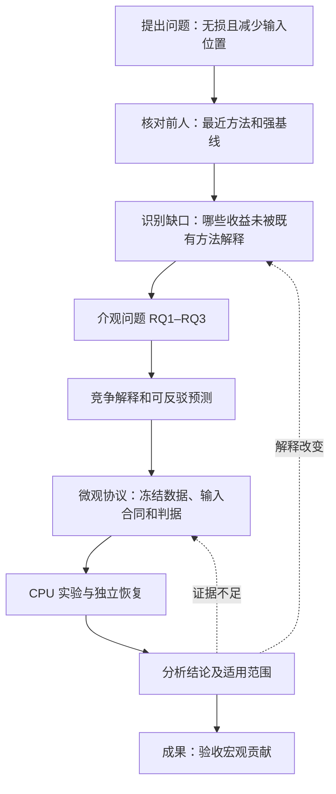

# 研究计划 Research Plan MBPE

## 2026-11-17 用模型损失学习无损 BPE 词表

**状态：已完成 CPU 计数模型先导。** 真实重切 loss 在位置收益接近的候选里提供了频次之外的排序信号。在单 token 计数模型上，部分预算同时小幅改善 loss 与输入位置；换两个 token 的计数模型后共同收益未复现。固定词表后最短切分的收益已另行验证，后续仍要单独回答用什么规则学词表。[词表选择证据](<../研究记录 Research Record/2026-11-17 损失引导选词与频次BPE.md>) · [现有图像证据](<../研究记录 Research Record/2026-11-17 原始RGB最短切分与学习覆盖.md>)

### 宏观目标：超过常规频次 BPE

在保证逐字节还原的前提下，找出比常规频次驱动 BPE 更有效的词表学习方法。在相同词表预算下，以同样的模型和训练预算比较两者：输入位置相近时，模型预测损失是否更低；预测损失相近时，输入位置是否更少。常规频次 BPE 是主基线。先固定相同的切分办法，隔离词表选择的作用，后续再把常规 BPE 的标准编码一并列入端到端对照。最终产物是一套可共享、可独立解码的词表及合并规则。

### 介观机制：用一次真实合并的影响决定收不收词条

从同一基础词表和同一字节预测模型出发。对当前词表能表示的相邻对 `A | B`，临时加入一个可逆词条 `AB → (A, B)`，重切同一批输入并测量带来的变化。评估两个量：原始数据对应的每字节预测损失变化，以及实际少掉多少输入位置。在节省的位置数相近时，优先选择损失更低的候选。两项指标有取舍时先保留各候选的实测结果，等有证据后再设定选择阈值。

借用 OBD 的思想是先定义一个离散改动，然后看它对损失的影响。这里的改动是给全局词表加一条可逆规则，并用它重切输入。首轮直接测改动前后的损失。保留基础字节，新增词条存精确展开关系，因此当模型和词表都固定后，任何合法 token 序列都能确定地展开。[OBD 原文 §2](https://proceedings.neurips.cc/paper/1989/file/6c9882bbac1c7093bd25041881277658-Paper.pdf)

### 微观验证：先确认 loss 能不能提供额外信号

1. 从 CIFAR-10 的同一份训练数据按非重叠频次取 32 个相邻对。频次分支在每档按可合并次数选规则，loss 分支在位置收益接近的候选里用独立打分集上的真实重切选规则。两支共用数据表示、256 个基础字节词条、按合并顺序切分以及冻结的计数模型。预测下一个字节时，以最后一个 token 的原始展开查询训练计数，低支持度向较短后缀退避。
2. 对同一个下一字节，先截出已经观察到的前缀，再重切并预测。在独立验证集复核每字节 loss 和整图位置变化。逐张从 token ID 和词表反向展开，核对原始 RGB。以 192 维 BF16 每位置 384 字节换算输入张量。
3. 多轮探索从同一基础词表起跑。按当前规则重切，再数相邻对。频次分支取最高频次，loss 分支只比较仍保留大部分即时长度收益的候选。按相同的最终规则预算复核，以测试集的 loss 与位置数共同判读。若只有某个小预算降 loss 或需更多位置，保留实测取舍，再决定是否扩展。

计数模型用来检验评价机制和对照是否成立。主实验读取最后一个 token 的原始展开，另用最后两个 token 作敏感性对照。合并会改变固定 token 窗口覆盖的原始历史长度。用相同输入位置预算比较完整神经模型，以及冻结和适应后 loss 的差异，留作后续验证。[研究结论](<../研究记录 Research Record/2026-11-17 损失引导选词与频次BPE.md>)

本轮 CPU 实验已收尾。等量化任务结束且 GPU 可用后，先筛选可本地运行、直接预测像素字节的预训练自回归图像 Transformer。冻结主模型，用小型输入适配器让新增词条实际占一个位置。两支使用相同适配预算，对同一批下一字节比较 loss，同时记录整图位置并逐张验无损。目前尚未选定模型。

## 2026-11-17 空间差分与通道差分

已完成主矩阵和新测试确认。横向二阶及三阶在 H6 上均比横向一阶长，单独的颜色差分有效。横纵各一阶在 H7 上使 SVHN 再少 5.91% 位置，CIFAR-10 则多 0.89%。后续保留绿色中心横向一阶作共同基线，并为 SVHN 加入已确认的横纵组合。每种扫描和数据集的对照分别记录。[研究结论](<../研究记录 Research Record/2026-11-17 空间差分阶数与颜色通道差分.md>) · [运行记录](<../运行记录 Run Record/2026-11-17 空间与颜色差分CPU对照.md>)

已有实验显示绿色中心颜色差分加横向一阶差分可显著缩短一维输入。这个结果把两个机制混在一起。此次询问更高阶能否进一步改善，以及颜色通道之间使用不同差分是否有效。宏观目标是为几何方案建立更强并可复查的一维基线。介观问题是空间阶数与通道变换各自的收益及交互。微观证据以同一图像逐图配对、固定词表预算及独立还原取得。沿用既有文献调研中的可逆颜色变换与固定词表最短分段资料。[前一轮结果](<../研究记录 Research Record/2026-11-17 原始RGB最短切分与学习覆盖.md>)

- 空间差分为逐行左差分，重复 0、1、2、3 次，保持每次首列并以模 256 运算。高阶可消去低阶平滑趋势，也可能放大纹理和噪声。以同颜色表示下的逐图位置差检验。
- 颜色表示比较 RGB 原坐标、绿色中心 `[G,R−G,B−G]`、RGB 链一阶 `[R,G−R,B−G]`、RGB 链二阶 `[R,G−R,B−2G+R]`。RGB 链顺序是固定实验约定。颜色与空间两因素交叉比较，使用每集相同 6000 学习图、按列扫描、逐通道切词、共享词表。预算为 20、40、60 万合并，实际规则数另记。固定 192 维 BF16，每位置 384 字节。
- H4 是已曝光配对集，每集 500 图，报告全部条件。可复用旧原值零阶、原值一阶及绿色中心一阶回执，输入身份和词表哈希必须一致。预先以 60 万规则的最短切分在 H4 分别选每集均值最低条件，平手优先绿色中心一阶，其余按固定候选次序。选定后在另留每集 500 张的新测试图上与绿色中心一阶、绿色中心二阶及三阶配对。新集排除已知训练、验证、旧测试的索引及原像素哈希。主指标是平均位置和按类分层的配对区间，输出每图长度及无计数独立解码回执。
- 单核 Idle，线程库各 1，worker 0，内存使用上限 8 GiB，系统可用下限 4 GiB。先运行绿色中心二三阶及颜色单独对照，再完成其余交叉条件，按完整矩阵选定后做新样本确认。约 40 分钟内以主矩阵与确认为优先。对用时和缺失项单列回执，保留上轮结果和工作区改动。

补充探索检验差分方向。在同一绿色中心表示下，以 H4 测试纵向一阶及横纵各一阶，扫描固定按列，匹配横向一阶与二阶的学习图、规则预算及切法。该项在主矩阵及独立确认后执行。H4 的方向探索单独报告，后续在未曝光图片确认再改变默认方向。

横纵组合在 H4 显示数据集差异。追加 H7 确认，同一套已封存的 60 万规则词表比较横向一阶与横纵各一阶，两集均报告。每集再留 500 张，按类均匀，另排除 H6。只有同一数据集 H7 也缩短，才把该方向列为待比较的一维基线。该追加选择只依据 H4 方向探索。

## 2026-11-17 本轮 CPU 协议

执行完成。原值 20 万规则，切换最短切分使 H2 再少约 10.7% 输入位置。H3 固定 20 万规则时，增大学习覆盖的收益超过 15 万→20 万的窄预算增加。扩大规则跨度后，两者都有作用。H5 确认在匹配条件下，按列颜色差分最短切分优于按行和 Hilbert。后续几何候选先对照这套固定 RGB 基线，任意形状的共享信息另行定义。[研究结论](<../研究记录 Research Record/2026-11-17 原始RGB最短切分与学习覆盖.md>) · [运行证据](<../运行记录 Run Record/2026-11-17 RGB学习覆盖与词表规模CPU对照.md>)

宏观目标仍是找出无损切词减少模型输入的位置，以及多维结构是否有独立作用。本轮先校准一维对照。原始 RGB 的 15 万到 20 万规则只多省约 0.53 个百分点，原因可能是词表预算、学习样本覆盖，或编码没有利用现有词表的全部切法。最短路径已有直接先例，本轮沿用既有文献调研中对 Kudo 分段的核对，将它作为实验控制。[已有原始 RGB 证据](<../研究记录 Research Record/2026-11-15 原始RGB大词表的独立长度收益.md>)

| 问题 | 预先确定的对照 | 判读 |
| --- | --- | --- |
| 原值词表下最短切分有多少收益 | 复用 CIFAR-10、SVHN 的 15 万和 20 万词表及 H2 测试图。比较普通切分与同词表单位成本最短路径 | 逐图不得变长，逐字节独立还原。均值差、分位数与减半覆盖用于描述实际收益 |
| 更多学习样本和更大预算各有多大作用 | 分数据集比较原始 RGB。嵌套学习量 300、1000、3000，预算 16,384、65,536、150,000、200,000。两种解析共用相同词表。新测试每集 500 张，按类平衡，排除已知旧池的索引及原始像素哈希 | 固定规则预算比较学习量，固定学习量比较预算。报告实际词条数和配对差。主要比较是 1000→3000 图与 15 万→20 万规则，其他档用于观察曲线 |

原始 uint8 RGB 保持 3×32×32，三通道按列展开并共享词表，按频率学习，最短切分以 token 数为目标。每位置按 192 维 BF16 的 384 字节计算。冻结方案及全部候选后评估新测试。H2 是已曝光配对消融。新测试的区间以冻结词表为条件，学习随机性另用替代抽样检查。若预算未达到，只比较实得规则并注明。单核 Idle，库线程各 1，worker 0，系统可用低于 4 GiB 或自身 RSS 超过 8 GiB 停止该进程。约 40 分钟内优先完成 H2、独立测试主对照和回执，再补学习抽样稳健性。数据不足或身份校验失败时保留回执，不混用测试数据。

稳健性预设使用三组新增学习抽样，种子 171131–171133。每组在官方学习源重新取按类平衡的嵌套 1000、3000 图，复用已冻结的新测试图，检查学习覆盖方向与 15 万→20 万预算方向是否跨抽样一致。抽样组之间允许重叠，逐组报告，不把三个种子当成独立测试集。若时间充足，用不同实现的单位成本动态规划抽查最短切分，并记录 CPU 编码耗时在相同环境下的变化。

主对照显示扩大覆盖的收益超过 15 万→20 万的窄预算增量。作为后续探索，在其余稳健性检查完成后，将学习量扩为同一原始池的嵌套 3000、6000 图，预算扩到 20 万、40 万、60 万，按相同口径比较两种解析。另冻结每集 500 张 H4，排除已记录的旧测试及本轮 H3。预先固定比较 3000→6000 图和 20 万→40 万→60 万规则。该探索回答收益是否继续，以及两因素是否交互，只对这次学习集和固定形状成立。若 40 分钟资源不足，按已完成数据集和档位记录。

H4 的学习覆盖敏感性再用 171144、171145 两个种子抽取额外 3000 张，保留共同的 3000 图起点及 H4 测试。只拟合新的 6000 图条件，直接复用共同起点词表和测试结果。种子间可能重叠，比较方向和范围。先完成主扩展再顺序运行，资源状态或剩余时间不适合时保留完成项。

H4 再比较匹配的可逆左差分与颜色加左差分。复用主扩展的 3000、6000 图及 20 万、40 万、60 万档，解析、计费和测试相同。若在 6000 图、60 万规则时预处理仍有收益，几何对照应继续采用匹配覆盖的最强一维。报告全部匹配条件，注明这是本轮新增的探索范围。

最后用 6000 图、60 万规则的颜色差分对照按行、按列和 Hilbert 扫描。复用 H4 的同一学习和测试清单，每套扫描单独学习，扫描顺序是共享配置。此项是已曝光 H4 上的一维基线敏感性检查。若扫描改变结果方向，后续在新验证集选择扫描后再用独立测试确认，避免把探索最优值当成新确认。

扫描的确认预设从旧池之外另留每集 500 张 H5。按 H4 的平均 token 数选择最短切分的扫描，平手保留按列，其余按行、Hilbert 的顺序。选择写入回执后才评估 H5。H5 固定比较入选扫描与按列，并报告三套值供复查。用同词表核对扫描选择，同时给出普通合并参照。若 H4 选出的扫描在 H5 变长，暂不改变默认基线。

运行后补充输入计费敏感性。复用 H5 已确认的扫描，按 batch=16 模拟相同到达顺序下的普通 BPE 和最短切分。使用固定 1000 个随机到达顺序，比较 FIFO 与窗口 128 长度排序的累计及最大单批位置。输入张量、逐样本 int32 长度和 bool mask 分开计费。该项是已有长度的组批核算。

原始 RGB 的 15 万/20 万普通 BPE 消融已完成。H2 上使用相同词表切法做配对对照。[同输入对照](<../研究记录 Research Record/2026-11-15 原始RGB大词表的独立长度收益.md>)

预算扩展已完成：[20 万规则与文本对照](<../研究记录 Research Record/2026-11-15 文本图像同宽位置与二十万规则.md>)。同一 H2 测试集上，相对 15 万再少约 1.71%/1.29% 位置；不再把这档列作未执行。优先学习覆盖与预算的分离，不能用已曝光测试调参后称新确认。

## 已有证据、当前缺口与下一步

**已有证据：** 固定 15 万条规则，CPU 上可逆颜色差分＋同词表最短解析，在新留出的 H2 每集 1000 图上将 CIFAR-10/SVHN 输入位置平均减少 **70.33%/79.43%**，全部逐图、独立无损。对齐多尺度颜色模板没有胜过强一维。详见[本轮结论](<../研究记录 Research Record/2026-11-15 颜色坐标与多尺度词表的输入收益.md>)和[运行证据](<../运行记录 Run Record/2026-11-15 颜色与层次候选CPU对照.md>)。

**当前缺口：** 已确立更强的一维对照，仍没有证据证明新颖的通用多维机制；也不知道当前收益多少取决于学习覆盖、固定尺寸与颜色统计。颜色变换、字典层次和最短分段都已有前人工作，不能重新命名为创新。

**后续方向：** 先用本轮拆分的词表规模、学习覆盖、颜色与解析结果冻结强一维合同，再判断几何候选是否有额外价值。后续选择扫描和候选时另留数据。任意形状完整合同仍待验证。

## 研究流程与宏观目标

宏观目标是在 Elsner 多维 BPE 基础上，研究适用于不同形状整数数据、保证逆映射且减少模型输入位置的方法。论文是传播有证据贡献的载体，不以跑完批次作为验收。当前流程已到“新对照实施→分析→返回缺口校准”，尚未确立论文新方法。各层目标沿同一流程衔接，不能把宏观目标写成孤立口号。

宏观验收需要：明确输入域和无损证明、与强一维的受控比较、额外信息完整计费及已有方法区别。当前只验收 CPU 编码与输入张量证据，不训练网络，不承诺 GPU 峰值、速度或任务质量。二维若没有独立作用，就收窄为适用边界并重新判断是否足以立题。

## 文献证据与介观研究问题

定向核对颜色可逆变换、二维字典与最短分段，实际阅读范围与来源见[文献调研](<../调研 Search/文献调研 Literature Search/文献调研 Literature Search MBPE.md>)。下一轮需围绕“非对齐形状＋组合复用＋强解析对照”补查最近工作，再决定是否开发；目前的新颖性待核实，不假设无人做过。

| 问题 | 当前判断与竞争解释 | 什么证据会改变判断 |
| --- | --- | --- |
| RQ1 固定同宽输入下，收益由预算、覆盖还是解析产生？ | 颜色和最短解析各有收益；大词表可能只是覆盖更多短模式 | 交叉预算和学习覆盖后差异消失，便不能归因新结构 |
| RQ2 几何/层次候选有强一维解释不了的作用吗？ | 本轮对齐方块失败；颜色计费不是唯一原因 | 相同预算和强解析下非对齐候选稳定减少净位置，并通过结构阴性对照 |
| RQ3 任意形状的无损合同与净输入收益能否同时成立？ | 部分旧原型可还原；新颜色/预测路线只覆盖固定 RGB | 孔洞、非矩形、3D、空域与未知值均有完备边信息和独立恢复，且收益不被其抵消 |

## 微观研究设计与判读规则

### M1：预算、覆盖与解析分离，优先

在现有单数据集内研究，不混合训练 CIFAR 与 SVHN。复用已有学习池做嵌套子集，例如 100/300/1000 图；预算 4096/16384/65536/150000。原通道与可逆颜色、原 BPE 与同词表最短解析交叉比较。高预算学习不足时报告实际词条数，不能补虚词或把预算当实得词表。

思想预测：若主要是词表规模，则同覆盖下预算主导；若跨颜色统计主导，破坏跨通道关联会削弱颜色收益；若解析浪费明显，同词表最短解析应逐图不更长。最后一项本轮已确认，应作为后续实现不变量，不能每轮都当新发现。

先按学习/验证协议确定条件和并列规则，查看未曝光数据前封存所有候选及主要比较；保留新的独立测试清单和重复内容审计。报告均值、分位数、逐图减半覆盖和配对区间。学习随机性至少以不同嵌套子集检查；单次固定模型 bootstrap 不能替代学习切分不确定性。

可改变判断的条件：预算收益饱和而覆盖继续有效，便优先覆盖；颜色与最短解析已解释几何候选收益，便停止以几何创新表述。资源不足时先减少同时驻留字典和并发，不以 GPU 训练替代本实验。

### M2：几何独立作用，有条件开展

先核对现有二维方法和可复用实现，再选一个可独立解码的几何候选。将 M1 的颜色差分＋按列＋最短切分作为当前强一维基线，固定相同原图、学习覆盖和实际规则预算。横竖条和紧凑块作为机制对照，逐图颜色、形状和方向参数纳入总位置数。对齐方块模板的已知结果可作为负对照。

微观验收先用小规模布局检查验证假设。保留每图取值直方图与形状尺寸，改变横竖方向或紧凑程度，观察几何方案相对固定一维基线的配对差是否随布局变化。另做保留直方图的像素打乱对照。若打乱后优势仍保持，说明该结果还不能归因于空间结构。真实图像评估再分两步进行。验证集选择几何候选和规则档，测试集单次比较，并记录配对差和独立恢复。两套数据分别执行。H5 的长度和预算曲线只用于设定基线。若候选在完整计费后没有净收益，记录适用边界并回到缺口判断。

### M3：任意形状合同，方法候选确定后衔接

定义整数域、坐标、掩码、边界和逆映射；空域、孔洞、非方形、三维、未知值与错误输入分别验证。uint8 模运算不能直接套用任意整数。先证明和独立恢复，再谈长度；形状和坐标额外占位置时合计，不能把固定 RGB 隐式位置合同推广为任意形状。

## 指标、资源与停止边界

主指标为内容及全部逐图边信息的总位置 T；同为 192 维 BF16，输入参考 384T 字节。共享词表 lookup 单列，文件大小旁列。变长组批另计真实 padding、长度与 mask；未运行组批时只报告未补齐输入，不能写成整网 GPU 峰值。

只用 CPU，最低优先级，最多 8 线程、4 worker；优先单重任务并设内存阈值，临时输出用本 repo/tmp。不改官方及 legacy、不训练神经网络、不做量化或超大下载。发现身份重叠、非无损、字典改变、参数漏计，停止受影响结果并保留失败，不静默回退。

运行记录保存每轮执行和资源回执。具体工程排期单列。[工程衔接](<开发计划 Development Plan MBPE.md>)

## 历史与接续

- [本轮分析前原研究计划](<计划存档 Plan Archive/2026-11-15 颜色层次候选运行前研究计划.md>)保留原协议、E1–E4 与旧微观细节。
- [大词表曲线](<../研究记录 Research Record/2026-11-15 大词表一维BPE的长度收益.md>)、[有限窗口及二维作用](<../研究记录 Research Record/2026-11-15 有限窗口收益与二维独立作用.md>)保留各自原合同。
- [阶段统合](<../研究报告 Research Report/2026-11-14 MBPE 研究统合报告.md>)是历史综合，不替代本页当前状态。
