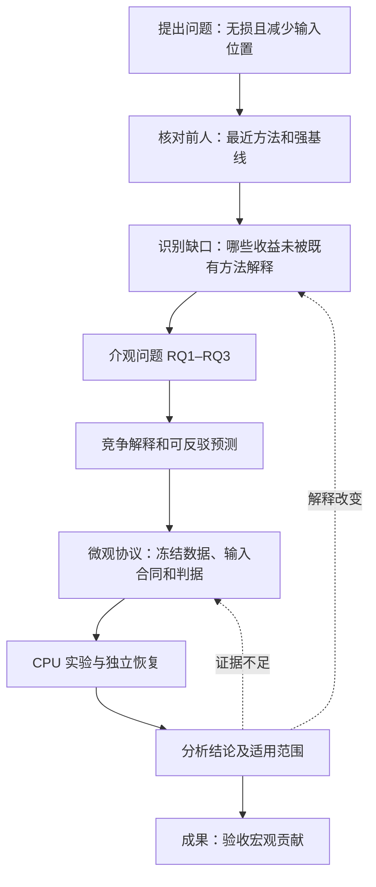

# 研究计划 Research Plan MBPE

原始 RGB 的 15 万/20 万普通 BPE 消融已完成：[同输入对照](<../研究记录 Research Record/2026-11-15 原始RGB大词表的独立长度收益.md>)。该项退出待验证，学习覆盖与预算分离仍待做；H2 已曝光。完整工程回归更新为 78 项通过。

预算扩展已完成：[20 万规则与文本对照](<../研究记录 Research Record/2026-11-15 文本图像同宽位置与二十万规则.md>)。同一 H2 测试集上，相对 15 万再少约 1.71%/1.29% 位置；不再把这档列作未执行。优先学习覆盖与预算的分离，不能用已曝光测试调参后称新确认。

## 已有证据、当前缺口与下一步

**已有证据：** 固定 15 万条规则，CPU 上可逆颜色差分＋同词表最短解析，在新留出的 H2 每集 1000 图上将 CIFAR-10/SVHN 输入位置平均减少 **70.33%/79.43%**，全部逐图、独立无损。对齐多尺度颜色模板没有胜过强一维。详见[本轮结论](<../研究记录 Research Record/2026-11-15 颜色坐标与多尺度词表的输入收益.md>)和[运行证据](<../运行记录 Run Record/2026-11-15 颜色与层次候选CPU对照.md>)。

**当前缺口：** 已确立更强的一维对照，仍没有证据证明新颖的通用多维机制；也不知道当前收益多少取决于学习覆盖、固定尺寸与颜色统计。颜色变换、字典层次和最短分段都已有前人工作，不能重新命名为创新。

**下一步：** 先分离词表规模、学习样本覆盖、颜色与解析的作用，再判断几何候选能否提供额外价值。H1/H2 已曝光，不用它们调参后冒充新验证。旧 E1/E2/E4 和预算曲线已经完成，不重复排为当前任务；任意形状完整合同仍未完成。

## 研究流程与宏观目标

宏观目标是在 Elsner 多维 BPE 基础上，研究适用于不同形状整数数据、保证逆映射且减少模型输入位置的方法。论文是传播有证据贡献的载体，不以跑完批次作为验收。当前流程已到“新对照实施→分析→返回缺口校准”，尚未确立论文新方法。各层目标沿同一流程衔接，不能把宏观目标写成孤立口号。

宏观验收需要：明确输入域和无损证明、与强一维的受控比较、额外信息完整计费及已有方法区别。当前只验收 CPU 编码与输入张量证据，不训练网络，不承诺 GPU 峰值、速度或任务质量。二维若没有独立作用，就收窄为适用边界并重新判断是否足以立题。

## 文献证据与介观研究问题

定向核对颜色可逆变换、二维字典与最短分段，实际阅读范围与来源见[文献调研](<../调研 Search/文献调研 Literature Search/文献调研 Literature Search MBPE.md>)。下一轮需围绕“非对齐形状＋组合复用＋强解析对照”补查最近工作，再决定是否开发；目前的新颖性待核实，不假设无人做过。

| 问题 | 当前判断与竞争解释 | 什么证据会改变判断 |
| --- | --- | --- |
| RQ1 固定同宽输入下，收益由预算、覆盖还是解析产生？ | 颜色和最短解析各有收益；大词表可能只是覆盖更多短模式 | 交叉预算和学习覆盖后差异消失，便不能归因新结构 |
| RQ2 几何/层次候选有强一维解释不了的作用吗？ | 本轮对齐方块失败；颜色计费不是唯一原因 | 相同预算和强解析下非对齐候选稳定减少净位置，并通过结构阴性对照 |
| RQ3 任意形状的无损合同与净输入收益能否同时成立？ | 部分旧原型可还原；新颜色/预测路线只覆盖固定 RGB | 孔洞、非矩形、3D、空域与未知值均有完备边信息和独立恢复，且收益不被其抵消 |

## 微观研究设计与判读规则

### M1：预算、覆盖与解析分离，优先

在现有单数据集内研究，不混合训练 CIFAR 与 SVHN。复用已有学习池做嵌套子集，例如 100/300/1000 图；预算 4096/16384/65536/150000。原通道与可逆颜色、原 BPE 与同词表最短解析交叉比较。高预算学习不足时报告实际词条数，不能补虚词或把预算当实得词表。

思想预测：若主要是词表规模，则同覆盖下预算主导；若跨颜色统计主导，破坏跨通道关联会削弱颜色收益；若解析浪费明显，同词表最短解析应逐图不更长。最后一项本轮已确认，应作为后续实现不变量，不能每轮都当新发现。

先按学习/验证协议确定条件和并列规则，查看未曝光数据前封存所有候选及主要比较；保留新的独立测试清单和重复内容审计。报告均值、分位数、逐图减半覆盖和配对区间。学习随机性至少以不同嵌套子集检查；单次固定模型 bootstrap 不能替代学习切分不确定性。

可改变判断的条件：预算收益饱和而覆盖继续有效，便优先覆盖；颜色与最短解析已解释几何候选收益，便停止以几何创新表述。资源不足时先减少同时驻留字典和并发，不以 GPU 训练替代本实验。

### M2：几何独立作用，有条件开展

先完成针对性文献比较，再只选一个有机制理由的非对齐或组合候选；本轮失败的方块模板不原样重跑。对照使用 M1 的颜色＋最短解析强一维，而非旧 256 条规则弱基线。相同原图、预算与训练覆盖，横竖条和紧凑块为机制对照；逐图颜色/形状/方向参数全部按输入合同计费。

预期若几何确有独立价值，应在保留内容频率但改变空间布局的对照中产生可解释差异；若完整参数计费后不胜强一维，就记录负结果并停止该候选。不得将未经核实的结构命名作为贡献。

### M3：任意形状合同，方法候选确定后衔接

定义整数域、坐标、掩码、边界和逆映射；空域、孔洞、非方形、三维、未知值与错误输入分别验证。uint8 模运算不能直接套用任意整数。先证明和独立恢复，再谈长度；形状和坐标额外占位置时合计，不能把固定 RGB 隐式位置合同推广为任意形状。

## 指标、资源与停止边界

主指标为内容及全部逐图边信息的总位置 T；同为 192 维 BF16，输入参考 384T 字节。共享词表 lookup 单列，文件大小旁列。变长组批另计真实 padding、长度与 mask；未运行组批时只报告未补齐输入，不能写成整网 GPU 峰值。

只用 CPU，最低优先级，最多 8 线程、4 worker；优先单重任务并设内存阈值，临时输出用本 repo/tmp。不改官方及 legacy、不训练神经网络、不做量化或超大下载。发现身份重叠、非无损、字典改变、参数漏计，停止受影响结果并保留失败，不静默回退。

当前用户授权的约 30–40 分钟轮次已完成研究设计、两批新测试与控制分析，实际回执见运行记录。此处登记下一轮协议方向，不冒充已经执行或产生新的发布授权。[工程衔接](<开发计划 Development Plan MBPE.md>)。

## 历史与接续

- [本轮分析前原研究计划](<计划存档 Plan Archive/2026-11-15 颜色层次候选运行前研究计划.md>)保留原协议、E1–E4 与旧微观细节。
- [大词表曲线](<../研究记录 Research Record/2026-11-15 大词表一维BPE的长度收益.md>)、[有限窗口及二维作用](<../研究记录 Research Record/2026-11-15 有限窗口收益与二维独立作用.md>)保留各自原合同。
- [阶段统合](<../研究报告 Research Report/2026-11-14 MBPE 研究统合报告.md>)是历史综合，不替代本页当前状态。
